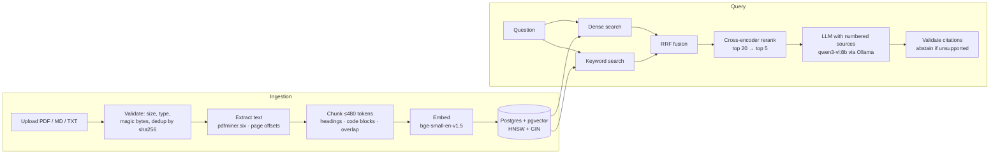

# Evidrix

[](https://github.com/shahriarkabir280/evidrix/actions/workflows/ci.yml)

**An evidence-grounded RAG assistant for technical documentation.** Evidrix answers questions
from your documents with citations that point to the exact passage, page and section — and says
*"I couldn't find this"* instead of guessing when the evidence isn't there.

It is built as a measurable system rather than a demo: hybrid retrieval and reranking are
compared on a labeled benchmark with confidence intervals, and every stage of the pipeline is
tested. It runs fully locally (Postgres + pgvector, sentence-transformers on Apple MPS, and a
local LLM through Ollama).

> **Status:** retrieval, generation and the evaluation harness work end to end. Production
> hardening (background jobs, auth, observability) and deployment are next — see
> [Roadmap](#roadmap).

---

## Highlights

- **Citations you can check.** Every answer cites numbered sources; citations that point to
  nothing are removed, and an answer left without a valid citation becomes an abstention.
- **Hybrid retrieval, measured.** Dense (bge-small) + Postgres full-text search, merged with
  Reciprocal Rank Fusion and rescored by a cross-encoder. Reranking improves MRR@5 by
  **+0.155 (95% CI +0.03 to +0.29)** over dense retrieval on the dev split.
- **A labeled benchmark.** 60 questions (factual, identifier, multi-hop, distractor,
  unanswerable) labeled with verbatim evidence quotes, a held-out test split, and bootstrap
  confidence intervals for every comparison.
- **Security in the query, not the prompt.** Owner, status and index-version filters are part of
  the SQL of every retrieval leg; another user's chunks are never candidates.
- **Honest failure modes.** Unanswerable questions abstain; a model reply cut off or not in the
  required JSON is retried once, then reported (502), never passed off as an answer.
- **Tested.** 282 tests (unit + integration against real Postgres) plus live tests against the
  local models; CI runs lint, migrations, a schema-drift check and the suite on every PR.

## Example

```bash
curl -s -X POST localhost:8000/chat -H 'Content-Type: application/json' \
  -d '{"question": "How do I declare a cookie parameter?"}'
```

```jsonc
// Abridged. The answer is from a real run; timings are typical for an Apple M4.
{
  "answer": "Declare a cookie parameter using `Cookie`, following the same pattern as `Query` and `Path`. For example: `ads_id: Annotated[str | None, Cookie()] = None` [1]. You can also use a Pydantic model with `Cookie` to group related cookies [4].",
  "abstained": false,
  "citations": [
    {"marker": 1, "document_title": "Cookie Parameters", "section_path": "Cookie Parameters > Declare `Cookie` parameters", "quote": "..."},
    {"marker": 4, "document_title": "Cookie Parameter Models", "section_path": "Cookie Parameter Models > Cookies with a Pydantic Model", "quote": "..."}
  ],
  "retrieved": [ /* the 5 passages the model saw, with per-stage ranks and scores */ ],
  "timings_ms": {"embed": 13, "retrieve_dense": 7, "retrieve_keyword": 4, "fuse": 0, "rerank": 169, "generate": 9900, "total": 10120},
  "config": {"retrieval": {"mode": "hybrid", "rerank": true, "top_k": 5}, "prompt_version": "answer_v1", "...": "..."}
}
```

A question the documents don't answer:

```text
Q: Does FastAPI include a built-in admin dashboard?
A: I couldn't find this in the selected documents.   (abstain_reason: no_valid_citations)
```

## How it works



**Ingestion.** Uploads are checked by extension *and* content (a renamed binary is rejected),
deduplicated per user by sha256, and stored content-addressed. PDF text comes from pdfminer.six
(pypdf dropped the spaces between words for some fonts — see [Engineering notes](#engineering-notes)).
The chunker splits by headings, paragraphs and fenced code blocks, never cuts a code block that
fits, keeps whole-sentence overlap within a section, and records each chunk's exact character
range, page range and section path (`Dependencies with yield > A database dependency with yield`).

**Retrieval.** Three presets in `configs/retrieval/*.toml`: `dense`, `hybrid` (dense + keyword,
20 candidates each, merged by `1 / (60 + rank)`), and `hybrid_rerank` (the default: the fused 20
rescored by `cross-encoder/ms-marco-MiniLM-L-6-v2`). `POST /retrieve` shows the ranked chunks and
how each stage ranked them, without calling the LLM.

**Generation.** A versioned prompt (`answer_v1`) puts numbered sources before the question and
treats source text as untrusted data (a document cannot close its `<source>` block or open a fake
one). The reply is JSON; citations must point to a retrieved source and appear in the answer
text. A context guard refuses prompts that would overflow the model's window, because Ollama
would otherwise drop the start of the prompt silently.

## Results

Dev split, 29 answerable questions, top 5. Mean with 95% bootstrap CI; Δ is the paired
difference against `dense`, and **bold** marks a difference whose interval excludes zero.

| Preset | Recall@5 | MRR@5 | nDCG@5 | All evidence@5 |
|---|---|---|---|---|
| `dense` | 0.828 [0.69, 0.95] | 0.707 [0.57, 0.83] | 0.686 [0.57, 0.80] | 0.793 [0.66, 0.93] |
| `hybrid` | 0.805 (Δ −0.023) | 0.770 (Δ +0.063) | 0.716 (Δ +0.030) | 0.724 (Δ −0.069) |
| `hybrid_rerank` | 0.914 (Δ +0.086) | **0.862 (Δ +0.155)** | **0.803 (Δ +0.117)** | 0.862 (Δ +0.069) |

What the data supports so far: reranking puts the right passage higher (MRR, nDCG). Hybrid vs
dense and the recall gains are within noise at this sample size. Answer quality (correctness,
faithfulness, abstention) is being measured next; the test split stays untouched until the final
report.

## Quickstart

**Prerequisites:** [uv](https://docs.astral.sh/uv/), Docker, and [Ollama](https://ollama.com)
(Apple Silicon or another machine that can run an 8B model).

```bash
git clone https://github.com/shahriarkabir280/evidrix.git && cd evidrix
uv sync                      # Python 3.12 + locked dependencies
cp .env.example .env

make up                      # Postgres 17 + pgvector on localhost:5433
make migrate                 # create the schema

ollama pull qwen3-vl:8b-instruct
OLLAMA_CONTEXT_LENGTH=8192 ollama serve      # in its own terminal

make dev                     # API on http://127.0.0.1:8000 (docs at /docs)
```

Load the evaluation corpus (FastAPI tutorial + Python HOWTO PDFs) and ask a question:

```bash
make corpus                                          # download + verify against the manifest
uv run python -m app.cli ingest-dir evals/corpus/raw # chunk + embed (~20 s on Apple MPS)
uv run python -m scripts.ask "How do I declare a cookie parameter?"
```

Or upload your own file:

```bash
curl -s -F "file=@guide.pdf" localhost:8000/documents
```

## API

| Method | Path | Purpose |
|---|---|---|
| `GET` | `/health` | Liveness |
| `POST` | `/documents` | Upload a PDF, Markdown or text file (deduplicated) |
| `GET` | `/documents`, `/documents/{id}` | List your documents / one document with its status |
| `POST` | `/retrieve` | Retrieval only, with per-stage ranks and scores |
| `POST` | `/chat` | Answer with citations, retrieved passages, timings and token usage |

`/chat` and `/retrieve` accept `document_ids` to restrict the search and a `retrieval` override,
e.g. `{"mode": "dense", "rerank": false, "top_k": 3}`. Errors: 404 unknown document, 409 still
processing, 422 invalid request, 502 unusable model output, 503 model unavailable.

## Evaluation

```bash
make eval                                    # retrieval metrics, every preset (seconds)
make eval-full PRESET=hybrid_rerank          # answers + LLM judge (minutes)
uv run python -m evals.report evals/results/<a>.json evals/results/<b>.json
```

- **Benchmark** (`evals/questions.jsonl`): 60 questions written from the source documents only —
  20 factual, 10 identifier, 10 multi-hop, 8 distractor, 12 unanswerable. Labels are verbatim
  quotes, resolved to character ranges at evaluation time, so the same labels work for any
  chunking. Splits (36 dev / 24 test) were fixed before any experiment; the test split needs
  `--final`.
- **Retrieval metrics:** Recall@5, all-evidence@5 (multi-hop), Hit@5, MRR@5, nDCG@5. A chunk
  "contains" a quote when it holds at least half of it.
- **Answer metrics:** correctness and faithfulness (claim by claim) graded by an LLM judge from a
  different model family, citation precision, and abstention precision/recall/false-abstention
  rate. The judge is calibrated on hand-labeled cases first (`python -m evals.calibrate_judge`).
- **Provenance:** every results file records the git commit, preset, models, prompt versions and
  the sha256 of the benchmark and corpus manifest.

## Engineering notes

Things the measurements caught that the original plan didn't:

- **Silent truncation.** `all-MiniLM-L6-v2` reads 256 tokens; with a 300-token passage plus an
  unrelated paragraph, its embedding was identical (cosine 1.0000) with or without the paragraph.
  Hence bge-small (512 tokens) and chunks capped at 480 tokens by the model's own tokenizer.
- **Glued words in PDFs.** pypdf dropped spaces for Type0/Identity-H fonts (4–8% of words in the
  Python HOWTOs: `Changingtheformatofdisplayedmessages`). Generated PDFs couldn't reproduce it,
  so a real page is kept as a regression fixture and pdfminer.six extracts the text.
- **AND vs OR keyword queries.** `websearch_to_tsquery` ANDs every word: 10 matching chunks for a
  natural question, 0 after adding one unknown word. Evidrix ORs the lexemes and lets ranking decide.
- **The judge needs calibrating.** `llama3.1:8b` agreed with 88% of hand-labeled verdicts and
  systematically penalized correct extra detail; prompt changes traded one error for another,
  so a stronger judge model is being calibrated.
- **Previews mislead.** On 10 hand-picked questions reranking looked useless (MRR 0.875 → 0.883);
  on the benchmark it is the only change with a significant gain.

Design decisions are recorded as ADRs: [pgvector](docs/adr/0001-postgres-pgvector.md) ·
[embedding model and chunk size](docs/adr/0002-embedding-model-and-chunk-size.md) ·
[keyword search](docs/adr/0003-keyword-search.md). The full build log is in
[docs/devlog.md](docs/devlog.md) and the plan in [docs/IMPLEMENTATION_PLAN.md](docs/IMPLEMENTATION_PLAN.md).

## Testing

```bash
make test        # unit + integration (needs `make up`)
make test-live   # against the real local models (needs Ollama)
make lint
```

Fakes (`FakeEmbedder`, `FakeLLM`, `FakeReranker`) are injected through FastAPI dependencies, so
production code has no test-only branches. Tests that need real models are marked `model` or
`live` and run locally; CI uses CPU-only torch and skips them.

## Configuration

Settings come from environment variables (see `.env.example`):

| Variable | Default | Meaning |
|---|---|---|
| `DATABASE_URL` | `postgresql+psycopg://…@localhost:5433/evidrix` | Postgres with pgvector |
| `EMBEDDING_MODEL` / `EMBEDDING_DEVICE` | `BAAI/bge-small-en-v1.5` / `auto` | Embedder; `auto` picks CUDA, then MPS, then CPU |
| `LLM_BASE_URL` / `LLM_MODEL` | `http://localhost:11434/v1` / `qwen3-vl:8b-instruct` | Any OpenAI-compatible endpoint |
| `LLM_CONTEXT_TOKENS` | `8192` | Must match the server (`OLLAMA_CONTEXT_LENGTH`) |
| `RETRIEVAL_PRESET` | `hybrid_rerank` | A file in `configs/retrieval/` |
| `MAX_UPLOAD_BYTES` | `10000000` | Upload size limit |

## Project structure

```text
app/
  api/            routes (documents, chat, retrieve), schemas, dependencies
  rag/            extract · chunking · embeddings · retrieval · rerank · llm · generation
  services/       ingestion and answering pipelines
  db/             SQLAlchemy models and repositories (all SQL lives here)
  storage/        content-addressed blob store
configs/retrieval/  dense · hybrid · hybrid_rerank presets
evals/            benchmark, metrics, judge, runner, report, results
migrations/       Alembic migrations
scripts/          corpus fetcher, ask
tests/            unit · integration · api, plus fakes and fixtures
docs/             plan, ADRs, devlog
```

## Roadmap

- [x] **Part 1** — API, Postgres + pgvector, document upload and extraction
- [x] **Part 2** — chunking, embeddings, dense retrieval, grounded answers with citations
- [x] **Part 3** — keyword search, hybrid fusion, reranking, `/retrieve`
- [ ] **Part 4** — evaluation harness *(retrieval metrics done; answer metrics in progress)*
- [ ] **Part 4b** — research papers: two-column PDFs, section headings, a paper benchmark
- [ ] **Part 5** — background ingestion jobs, API keys, rate limits, prompt-injection tests
- [ ] **Part 6** — persisted chats, cost and latency tracking, load test
- [ ] **Part 7** — Docker image, hosted deployment, smoke tests
- [ ] **Part 8** — final evaluation on the held-out split, report, demo

## Limitations

- The benchmark has 60 questions written by a single annotator (who also built the system), with
  no second-annotator review; small differences between configurations are not significant.
- The corpus is one domain (FastAPI tutorial + four Python HOWTOs); research papers are not yet
  covered.
- Answers come from a local 8B model; generation dominates latency (~10–18 s on an Apple M4).
- Keyword ranking uses Postgres `ts_rank_cd`, not BM25.
- Scanned PDFs (no text layer) are rejected; there is no OCR.

## License

[MIT](LICENSE). The evaluation corpus is downloaded, not committed: the FastAPI documentation is
MIT-licensed and the Python documentation is under the PSF License;
`tests/fixtures/glued-words-cid-fonts.pdf` is one page from the Python docs (PSF-2.0).
