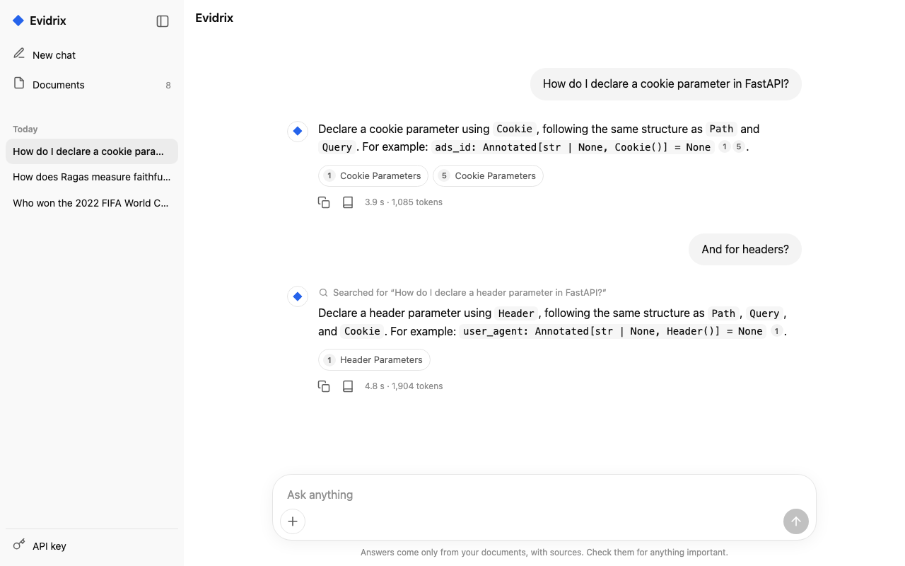
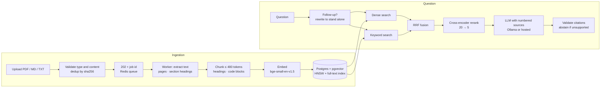
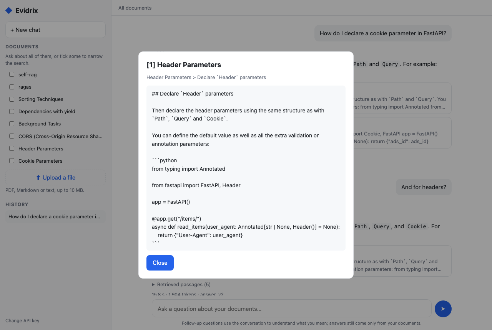

# Evidrix

[](https://github.com/shahriarkabir280/evidrix/actions/workflows/ci.yml)

[](LICENSE)

**Evidence-grounded question answering over technical documentation and research papers.**
Evidrix answers from your own documents, cites the exact passage, page and section behind every
claim, and says *"I couldn't find this"* instead of guessing.

It is built as a measurable system, not a demo. Every retrieval change was tested on a labeled
benchmark with a held-out split and confidence intervals, and every failure of the final system
was classified. It runs fully locally (FastAPI, Postgres with pgvector, Redis and an 8B model
through Ollama) or with any OpenAI-compatible hosted model.

**At a glance:** reranking lifts MRR@5 by **+0.193** over dense retrieval on a held-out split ·
answers **0.857** correct and **1.000** faithful to their sources · **all** unanswerable test
questions declined · **469** automated tests at 92% coverage · a ChatGPT-style web page with
follow-up questions.

<p align="center">
  
</p>

---

## Contents

1. [Highlights](#highlights)
2. [Tech stack](#tech-stack)
3. [Results](#results)
4. [How it works](#how-it-works)
5. [Quickstart](#quickstart)
   - [Using a hosted model](#using-a-hosted-model)
6. [Using Evidrix](#using-evidrix)
   - [Web page](#web-page)
   - [API](#api)
7. [Evaluation](#evaluation)
8. [Engineering notes](#engineering-notes)
9. [Operations](#operations)
10. [Deployment](#deployment)
11. [Development](#development)
12. [Documentation](#documentation)
13. [Limitations](#limitations)
14. [License](#license)

## Highlights

- **Citations you can check.** Every claim points to a numbered source; click it to read the
  passage. Citations that point to nothing are removed, and an answer left without a valid
  citation becomes an abstention.
- **Retrieval chosen by experiment.** Dense search (bge-small) and Postgres full-text search,
  fused with Reciprocal Rank Fusion and reranked by a cross-encoder. On the held-out test split,
  reranking improves MRR@5 by **+0.193 (95% CI +0.05 to +0.35)** over dense retrieval; fusion
  alone, smaller chunks and more passages did not help.
- **Follow-up questions.** "And for headers?" is rewritten into a standalone question before the
  search, and the page shows what was searched. Earlier turns help to understand a question;
  they are never a source.
- **Security in the query, not the prompt.** Every query a request can reach filters by owner
  in SQL, so another user's chunks are never even candidates. API keys are stored hashed,
  requests are rate-limited per user, and a prompt-injection suite found an attack the first
  prompt let through ([security model](docs/security.md)).
- **Reliable ingestion.** Uploads return `202` at once; a background worker extracts, chunks and
  embeds, retries transient errors with backoff, writes each document in one transaction, and
  recovers jobs from a crashed worker.
- **Observable.** Every answer is stored with the retrieved passages and their scores, tokens,
  cost and time per stage; logs are JSON lines that carry one request ID from the API into the
  worker.
- **Local or hosted models.** The answer model is any OpenAI-compatible endpoint: a local model
  through Ollama by default, or a hosted one such as a free model on OpenRouter, set in `.env`.
- **Tested.** 469 Python tests (unit and integration against real Postgres, 92% coverage) and
  rendering tests for the web page in CI, plus tests against the real local models.

## Tech stack

| Area | Technologies |
|---|---|
| API | Python 3.12, FastAPI, Pydantic v2, uvicorn |
| Data | PostgreSQL 17 with pgvector (HNSW) and full-text search, SQLAlchemy 2, Alembic |
| Retrieval | sentence-transformers: `bge-small-en-v1.5` embeddings, `ms-marco-MiniLM-L-6-v2` cross-encoder; Reciprocal Rank Fusion |
| Generation | Ollama (`qwen3-vl:8b`) or any OpenAI-compatible API, JSON output with citation validation |
| Background work | Redis, RQ, retries with backoff, job recovery |
| Web page | HTML, CSS and JavaScript modules, no framework or build step, strict Content-Security-Policy |
| Evaluation | Labeled benchmarks, LLM judge (`gemma3:12b`), bootstrap confidence intervals, ablations |
| Operations | Docker (multi-stage, uv), GitHub Actions CI, structlog JSON logs, pytest, Node test runner |

## Results

Held-out test split: 35 questions over both benchmarks, each configuration run once, answers
graded by a calibrated `gemma3:12b` judge. Full numbers with 95% intervals, the per-benchmark
breakdown and the error analysis are in the [report](docs/REPORT.md).

| Configuration | Recall@5 | MRR@5 | Correctness | Faithfulness | Prompt tokens |
|---|---|---|---|---|---|
| E1 dense | 0.696 | 0.571 | 0.768 | 0.996 | 1,810 |
| E2 hybrid (RRF) | 0.661 | 0.487 | 0.750 | 0.917 | 1,944 |
| **E3 hybrid + rerank** (default) | **0.821** | **0.764** | **0.857** | **1.000** | 1,874 |
| E4 E3 with 256-token chunks | 0.768 | 0.717 | 0.786 | 0.990 | 1,379 |
| E5 E3 with top 3 / top 8 | 0.732 / — | 0.750 / — | 0.821 / 0.839 | 0.968 / 1.000 | 1,269 / 2,901 |

- **Reranking is the change that helps.** Its gains in Recall, MRR and nDCG over dense retrieval
  exclude zero; its answer gain (+0.089) points the same way but, with 28 answerable questions,
  is not yet significant.
- **Every configuration abstained on all 7 unanswerable questions.**
- **Of the default's 14 failures** (test and dev): 6 retrieval, mostly a multi-hop question whose
  second document never reached the top 5; 2 table extraction; 2 false abstentions; 4 judge
  errors.
- **Cost.** About 1,800 prompt and 50 completion tokens per question, $0 with the local model;
  generation is ~94% of the latency ([performance](docs/perf.md)).

## How it works



**Ingestion.** Uploads are checked by extension *and* content (a renamed binary is rejected),
deduplicated per user, and stored by content hash. PDF text comes from pdfminer.six with
ligatures and hyphenation repaired and numbered section headings detected. The chunker splits
by headings, paragraphs and code blocks, never cuts a code block that fits, and records each
chunk's exact character range, page range and section path
(`Dependencies with yield > A database dependency with yield`).

**Retrieval.** Presets in `configs/retrieval/*.toml`. The default, `hybrid_rerank`, takes 20
candidates each from dense and keyword search, fuses them by rank, and reranks them with
`cross-encoder/ms-marco-MiniLM-L-6-v2`; the best 5 go to the model.

**Generation.** A versioned prompt (`answer_v2`) puts numbered sources before the question and
treats their text as untrusted data. The reply must be JSON, and every citation must point at a
retrieved source; a model that lists its sources without marking them in the text has them
attached to the answer. A context guard refuses prompts that would overflow the model's window
(Ollama would silently drop the start). When the user picks the documents, the model judges the
passages itself; otherwise a calibrated reranker score below which it abstains spares a model
call.

**Follow-ups.** With a `conversation_id`, the last three turns are used to rewrite the question
into a standalone one (prompt `condense_v2`), which is then searched and answered like a first
question.

## Quickstart

**Requirements:** [uv](https://docs.astral.sh/uv/), Docker, and [Ollama](https://ollama.com) on
a machine that can run an 8B model (an Apple Silicon Mac with 16 GB works).

```bash
git clone https://github.com/shahriarkabir280/evidrix.git && cd evidrix
uv sync && cp .env.example .env
make up && make migrate                          # Postgres + pgvector, Redis; schema

ollama pull qwen3-vl:8b-instruct
OLLAMA_CONTEXT_LENGTH=8192 ollama serve          # separate terminal

make dev                                         # API on http://127.0.0.1:8000
make worker                                      # separate terminal: processes uploads
uv run python -m app.cli create-user --email you@example.com   # prints your API key once
```

Open **http://127.0.0.1:8000/ui/**, paste the key, upload a few documents and ask away.

### Using a hosted model

The answer model is any OpenAI-compatible endpoint, so a larger hosted model needs only settings
in `.env`, for example a free model on [OpenRouter](https://openrouter.ai/models):

```bash
LLM_BASE_URL=https://openrouter.ai/api/v1
LLM_API_KEY=sk-or-...                                   # from openrouter.ai/keys; never commit it
LLM_MODEL=nvidia/nemotron-3-super-120b-a12b:free
LLM_CONTEXT_TOKENS=32768
LLM_RESPONSE_FORMAT=json_schema                         # json_object for models with JSON mode only
LLM_MAX_OUTPUT_TOKENS=2048                              # reasoning models think before answering
```

Tried with `nvidia/nemotron-3-super-120b-a12b:free`: it answered a two-paper question that the
local 8B model got wrong, resisted all four planted instructions in the injection suite, and,
unlike the local model with `answer_v2`, repeated a false statement planted in a document.
Embeddings and reranking stay local. Two things change with a hosted model: your documents'
text is sent to the provider (free endpoints may log prompts), and the published results were
measured with the local `qwen3-vl:8b`, so re-run `make eval-full` to measure another model.

To try it on the evaluation corpus instead (FastAPI tutorial, four Python HOWTOs, eight
retrieval papers):

```bash
make corpus                                          # download, verify against the manifest
uv run python -m app.cli ingest-dir evals/corpus/raw
uv run python -m app.cli create-key --email dev@evidrix.local   # the owner of that corpus
```

## Using Evidrix

### Web page

`/ui` is a chat page in the style of ChatGPT, served by the API with no build step:

- **Ask anything.** A new chat is an empty page and a box; there is no list of topics to pick from.
- **Attach files with `+`.** Upload a file or pick documents to search; they show as chips above
  the box, with their processing status, and a question waits until they are ready.
- **Check every claim.** Citation numbers and source pills open a side panel with the passage,
  its document and section; the panel also lists the other passages that were searched.
- **Follow up.** The conversation continues where it left off, and a follow-up shows what it was
  searched as. History is grouped by day, as in ChatGPT.
- **Honest answers.** A question the documents don't answer says so instead of guessing.

<p align="center">
  
  
</p>
<p align="center">
  
</p>

### API

Interactive documentation is at `/docs`. Every endpoint except `/health`, `/ready` and the page
needs `Authorization: Bearer evx_…`.

| Method | Path | Purpose |
|---|---|---|
| `POST` | `/documents` | Upload a PDF, Markdown or text file; `202` with a job id |
| `GET` | `/documents`, `/documents/{id}` | Your documents and their processing status |
| `GET` | `/jobs/{id}` | Ingestion status, attempts and last error |
| `POST` | `/chat` | An answer with citations, the retrieved passages, timings, tokens and cost; send `conversation_id` to follow up |
| `POST` | `/retrieve` | Retrieval only, with each stage's ranks and scores |
| `GET` | `/chats`, `/chats/{id}` | Your history; one exchange with its full retrieval trace |
| `GET` | `/health`, `/ready` | Liveness; readiness of the database and Redis |

```bash
AUTH="Authorization: Bearer $EVIDRIX_API_KEY"
curl -s -H "$AUTH" -F "file=@guide.pdf" localhost:8000/documents
curl -s -H "$AUTH" -H 'Content-Type: application/json' \
  -d '{"question": "How do I declare a cookie parameter?"}' localhost:8000/chat
```

```jsonc
// A real response, abridged (MacBook Air M4)
{
  "answer": "Declare a cookie parameter using `Cookie`, following the same structure as `Query` and `Path`. For example: `ads_id: Annotated[str | None, Cookie()] = None` [1].",
  "abstained": false,
  "citations": [{"marker": 1, "document_title": "Cookie Parameters", "section_path": "Cookie Parameters > Declare `Cookie` parameters", "quote": "…"}],
  "conversation_id": "0ceb1398-…",
  "retrieved": [ /* the 5 passages the model saw, with dense, keyword and rerank scores */ ],
  "usage": {"prompt_tokens": 963, "completion_tokens": 61, "llm_calls": 1, "cost_usd": 0.0},
  "timings_ms": {"embed": 177, "retrieve_dense": 10, "retrieve_keyword": 4, "fuse": 0, "rerank": 167, "generate": 5851, "total": 6211}
}
```

`/chat` and `/retrieve` also accept `document_ids` to narrow the search and a `retrieval`
override such as `{"mode": "dense", "top_k": 3}`. Errors share one shape, with a stable code and
the request ID to quote: `{"error": {"code": "document_not_ready", "message": "…", "request_id": "…"}}`.

## Evaluation

```bash
make eval                                        # retrieval metrics for every preset (seconds)
make eval-full PRESET=hybrid_rerank              # answers + LLM judge on the dev split
uv run python -m evals.ablations                 # the report's tables, from the test runs
```

- **Benchmarks.** 60 questions on documentation and 24 on research papers (factual, identifier,
  multi-hop, distractor, table, unanswerable), written from the sources and labeled with
  verbatim evidence quotes, so the same labels work for any chunking. Dev and test splits were
  fixed before any experiment; the runner refuses the test split without `--final`.
- **Metrics.** Recall, MRR and nDCG at 5; answer correctness and claim-by-claim faithfulness from
  an LLM judge of a different model family, calibrated on hand-labeled cases first; citation
  precision; abstentions. Every comparison has a bootstrap confidence interval.
- **Provenance.** Every results file records the commit, models, prompt versions, index version
  and the hashes of the benchmark and corpus.
- **Beyond answers.** A prompt-injection suite (`evals.injection`), a follow-up rewrite check
  (`evals.condense_check`) and a load test (`scripts/loadtest.py`).

## Engineering notes

What the measurements caught that a plan wouldn't have. The full log is in
[docs/devlog.md](docs/devlog.md).

- **Concurrency crashed the API.** Four parallel requests segfaulted it: FastAPI runs sync
  endpoints in a thread pool, and PyTorch's Apple-GPU backend isn't thread-safe. A lock around
  model calls fixed it; one request at a time had never shown it.
- **Retries under overload added work.** Requests queued inside Ollama timed out and were retried
  while Ollama finished the abandoned ones. LLM calls now queue in the API, which answers
  `503 llm_busy` when no slot frees up in time.
- **A control run prevented a wrong conclusion.** After two hours of load the fanless laptop
  generated 4× slower with the same code; without the control run, the slowdown would have been
  blamed on concurrency.
- **The injection that worked didn't look like one.** "Ignore all previous instructions" failed
  even with the defenses off; a planted "citation policy" asking for a code after each citation
  succeeded. A reminder placed after the sources stopped it at no measurable cost.
- **The error analysis found a bug, not a failure.** `x[1]` in a code answer was parsed as a
  citation, so the judge graded `lambda x: x`. Fixed in both the app and the judge, and the
  affected answers re-scored with the change recorded in their provenance.
- **The judge needs checking too.** `llama3.1:8b` agreed with 14 of 16 hand-labeled verdicts,
  `gemma3:12b` with all 16; still, 4 of the final system's 14 failures were judge errors.
- **Silent truncation.** A 256-token embedding model returned the same vector with or without an
  unrelated paragraph; hence bge-small (512 tokens) and chunks capped by its own tokenizer.
- **Measure before fixing.** Two-column papers were expected to scramble the reading order; they
  didn't. The real problems were ligatures (`fine-tune`) and PDF chunks without section paths.
- **A better title made retrieval worse.** arXiv PDFs have no title in their metadata, so they
  were listed by file name. Reading the title from the first page and putting it in every
  chunk's header lowered paper MRR@5 (dev 0.712 → 0.659, test 0.522 → 0.500): a long title adds
  the same words to every chunk. Users now see the real title; the index keeps the one it was
  measured with.

Design decisions are recorded as architecture decision records (ADRs):

- [ADR-0001](docs/adr/0001-postgres-pgvector.md): Postgres with pgvector instead of a separate vector database
- [ADR-0002](docs/adr/0002-embedding-model-and-chunk-size.md): the embedding model and the chunk size
- [ADR-0003](docs/adr/0003-keyword-search.md): keyword search with Postgres full-text search
- [ADR-0004](docs/adr/0004-api-key-storage.md): API keys stored as hashes and looked up by hash
- [ADR-0005](docs/adr/0005-no-caching-yet.md): no query or answer cache, for now

## Operations

- **Access control.** API keys (`evx_` + 32 random bytes) stored as sha256 and created with the
  CLI; a missing, unknown or revoked key gets `401`, and another user's resource is a `404`. A
  test fails if a repository function that reads user data has no owner filter.
- **Rate limits.** Per user and route (`/chat` 20, `/retrieve` 60, uploads 10 per minute), `429`
  with `Retry-After`; if Redis is down the limiter lets requests through rather than taking
  reads down with it.
- **Ingestion.** Transient errors are retried after 10 s, 1 min and 5 min; permanent ones fail at
  once; `app.cli reap-jobs` recovers jobs from a dead worker; re-uploading a failed file retries
  it.
- **Logs and traces.** JSON lines with a request ID that follows a request into the worker.
  Questions are logged as length and hash; keys, questions, answers and document text never are.
- **Performance.** Retrieval with reranking takes ~0.3 s; generation dominates. Ollama needs
  10–11 GB and the API 1.6 GB on a Mac; in a Linux container the API peaks at 687 MiB, or 488 MiB
  with a smaller reranker batch and one thread ([performance](docs/perf.md),
  [deployment](docs/deploy.md)).

## Deployment

One Docker image serves the API and the worker; all settings come from environment variables.

```bash
make prod-up                                     # API, worker, Postgres, Redis in containers (:8080)
docker compose -f docker-compose.prod.yml run --rm api python -m app.cli create-user --email you@example.com
make smoke URL=http://localhost:8080 KEY=evx_…   # end-to-end check of a deployment
```

Migrations run as a release step that the API and worker wait for, never at application
startup. A smaller deployment can run ingestion inside the API process, keep uploads in Postgres,
and turn `/chat` off for a retrieval-only demo; [docs/deploy.md](docs/deploy.md) has the memory
measurements behind those options and the steps for a Hugging Face Space with Neon and Upstash.

## Development

```bash
make test          # unit + integration tests (needs make up)
make test-ui       # the web page's rendering tests (Node)
make test-live     # against the real local models (needs Ollama)
make lint
```

Fakes for the embedder, reranker, model and queue are injected through FastAPI dependencies, so
production code has no test-only branches. CI runs lint, the page's tests, migrations, a
schema-drift check, the test suite with a coverage floor of 85%, and a Docker build on every pull
request.

<details>
<summary><b>Configuration</b></summary>

Settings come from environment variables (see `.env.example`).

| Variable | Default | Meaning |
|---|---|---|
| `DATABASE_URL` | `postgresql+psycopg://…@localhost:5433/evidrix` | Postgres with pgvector |
| `REDIS_URL` | `redis://localhost:6379/0` | Job queue and rate-limit counters |
| `LLM_BASE_URL` / `LLM_MODEL` | `http://localhost:11434/v1` / `qwen3-vl:8b-instruct` | Any OpenAI-compatible endpoint |
| `LLM_CONTEXT_TOKENS` | `8192` | Must match the server (`OLLAMA_CONTEXT_LENGTH`) |
| `LLM_TIMEOUT_SECONDS` / `LLM_MAX_CONCURRENCY` | `60` / `1` | Per call; calls in flight (match the server's parallelism) |
| `LLM_RESPONSE_FORMAT` | `json_schema` | `json_object` or `none` for models without schema support |
| `EMBEDDING_MODEL` / `EMBEDDING_DEVICE` | `BAAI/bge-small-en-v1.5` / `auto` | `auto` picks CUDA, then Apple MPS, then CPU |
| `RETRIEVAL_PRESET` | `hybrid_rerank` | A file in `configs/retrieval/` |
| `ANSWER_PROMPT_VERSION` | `answer_v2` | A prompt in `app/rag/prompts/` |
| `RATE_LIMIT_CHAT_PER_MINUTE` | `20` | Also `…_RETRIEVE_…` (60) and `…_UPLOAD_…` (10) |
| `INGESTION_MODE` | `rq` | `inline`: run jobs in the API process (single instance) |
| `BLOB_BACKEND` | `local` | `postgres`: keep uploads in the database |
| `CHAT_ENABLED` | `true` | `false`: retrieval-only deployment |
| `MAX_UPLOAD_BYTES` | `10000000` | Upload size limit |
| `LOG_JSON` / `LOG_LEVEL` | `true` / `INFO` | JSON lines with `request_id` |

</details>

<details>
<summary><b>Project structure</b></summary>

```text
app/
  api/          routes, schemas, dependencies, error envelope, request middleware, rate limits
  rag/          extraction, chunking, embeddings, retrieval, reranking, LLM, generation,
                follow-up rewriting, prompts
  services/     ingestion and answering pipelines
  db/           SQLAlchemy models and repositories (all SQL lives here)
  storage/      blob stores: local files or Postgres
  worker/       RQ queue, job functions, inline ingestion
  ui/           the web page (HTML, CSS and JavaScript modules, no build step)
configs/        retrieval presets, model prices
evals/          benchmarks, metrics, judge, runner, ablations, error analysis, results
migrations/     Alembic migrations
scripts/        corpus fetcher, load test, smoke test, ablation runner
tests/          unit, integration, API, security and page tests, with fakes and fixtures
deploy/         Hugging Face Space configuration
docs/           report, performance, security, deployment, ADRs, devlog, plan
```

</details>

## Documentation

| Document | Contents |
|---|---|
| [Report](docs/REPORT.md) | The research question, setup, benchmark, ablations with intervals, error analysis |
| [Performance](docs/perf.md) | Load tests: latency per stage, throughput, memory, what the measurements changed |
| [Security model](docs/security.md) | Threat model, defenses, prompt-injection measurements, what is not defended |
| [Deployment](docs/deploy.md) | Container memory, hosting decisions, release-step migrations, setup steps |
| [Architecture decisions](docs/adr/) | Five ADRs, from pgvector to caching |
| [Devlog](docs/devlog.md) | What each part built, measured and got wrong |
| [Implementation plan](docs/IMPLEMENTATION_PLAN.md) | The original plan, with each part's status |

## Limitations

- **Small benchmark, single annotator.** 84 questions written and labeled by the author, with no
  second annotator; small differences between configurations are within noise.
- **Two kinds of documents.** Technical documentation and retrieval papers; tables in PDFs lose
  their row structure, and scanned PDFs are rejected (no OCR).
- **Multi-hop questions** that need two documents are the largest failure category.
- **Measured with one model.** The results are for the local `qwen3-vl:8b`, which generates one
  answer at a time; hosted models work through the same settings but have not been benchmarked.
- **Keyword ranking** uses Postgres `ts_rank_cd`, not BM25.

## License

[MIT](LICENSE). The evaluation corpus is downloaded, not committed: the FastAPI documentation is
MIT-licensed, the Python documentation is under the PSF License, and the eight papers are
CC BY or CC BY-SA (each recorded in `evals/corpus/manifest.json`).
`tests/fixtures/glued-words-cid-fonts.pdf` is one page from the Python documentation (PSF-2.0).
